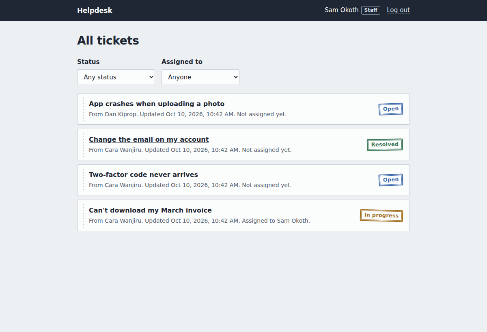
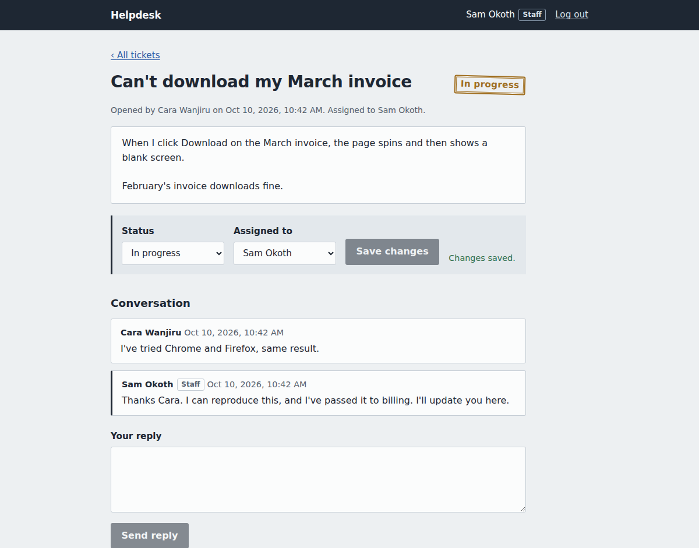
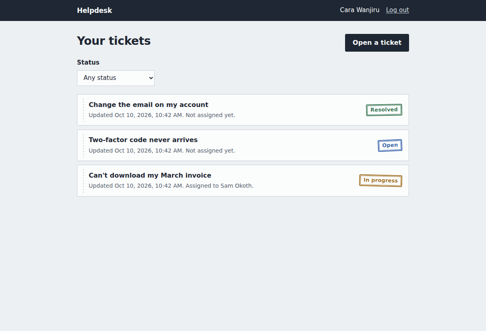
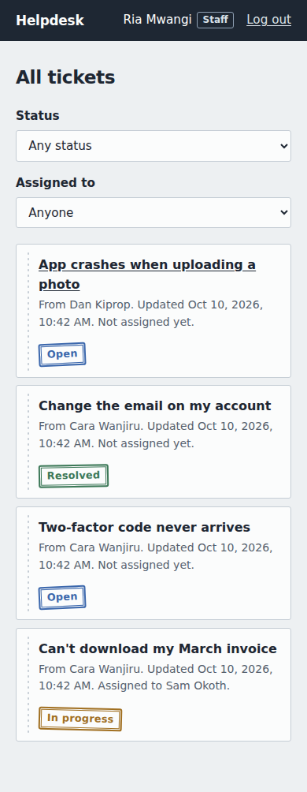
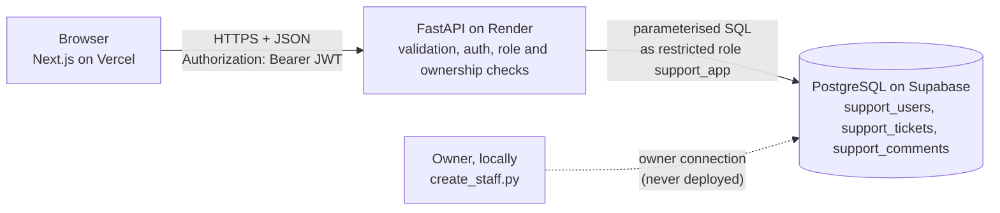
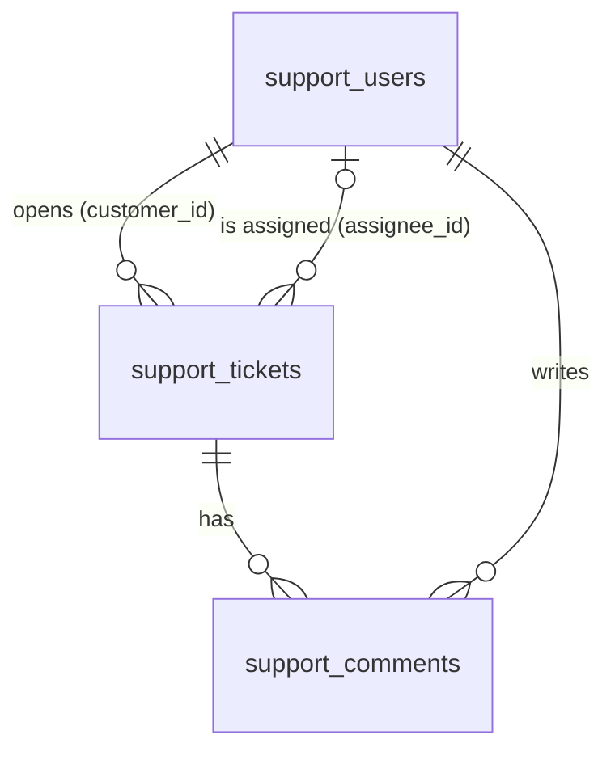

# Support Ticket System


A helpdesk where customers open support tickets and staff manage them. Customers see and follow only their own tickets; staff see every ticket, assign them, change their status and reply in a comment thread.

The point of the project is **role-based access control enforced on the server**: one backend serves two kinds of users with different permissions, and every rule is checked by the API and the database, not by the UI.

**Live demo:** https://support-ticket-system-sigma-two.vercel.app
**API health check:** https://support-ticket-api-p047.onrender.com/health

> The backend runs on Render's free tier, which sleeps after 15 minutes without traffic. The first request after that can take up to a minute.

## Screenshots

| Staff queue | Ticket, staff view |
|---|---|
|  |  |

| Customer's tickets | Mobile |
|---|---|
|  |  |

## Features

- **Customers:** register, log in, open tickets, follow their status, reply in the thread.
- **Staff:** see all tickets, filter by status or assignee ("me", "nobody yet", a colleague), assign tickets, change status (Open, In progress, Resolved), reply.
- **Ownership:** a customer who requests someone else's ticket gets "not found", exactly as if it didn't exist.
- **No self-promotion to staff:** public sign-up always creates a customer. Staff accounts are created by the owner with a script, and the app's database role is physically unable to create them.
- One consistent JSON error format, friendly messages in the UI, no stack traces or SQL ever shown.

## Tech stack

- **Frontend:** Next.js 16 (App Router), TypeScript, plain CSS. Deployed on Vercel.
- **Backend:** FastAPI, Pydantic, psycopg 3 (connection pool), PyJWT, Argon2. Deployed on Render (Frankfurt).
- **Database:** PostgreSQL on Supabase, connected through the Session pooler.
- **Tests:** pytest against a real PostgreSQL (64 tests), Playwright browser walkthrough, GitHub Actions CI.

## Architecture



The browser never talks to the database. The backend is the only thing that does, and it only returns JSON. The API contract in [`docs/openapi.yaml`](docs/openapi.yaml) was written before any code, and a test fails if the backend drifts from it.

### Data model



## How each architecture rule is applied

| Rule | Where it's implemented |
|---|---|
| Separation of layers | `frontend/` only calls the API through [`src/lib/api.ts`](frontend/src/lib/api.ts). It has one setting, the public API URL. The backend returns JSON only. |
| API-first | [`docs/openapi.yaml`](docs/openapi.yaml) came first. [`tests/test_contract.py`](backend/tests/test_contract.py) compares the app's routes, methods and success codes with it. |
| Single source of truth | All state is in PostgreSQL. Who can see or change what is decided in the backend; the frontend hides staff controls for convenience only. |
| Schema design | [`db/schema.sql`](db/schema.sql): foreign keys, `NOT NULL`, `UNIQUE`, `CHECK` on status, role, lengths and lowercase email. Each index has a comment saying which query it serves. |
| Validation at the boundary | Pydantic models in [`app/schemas.py`](backend/app/schemas.py) for every body, path and query parameter, with unknown fields rejected. All SQL in [`app/repo.py`](backend/app/repo.py) uses parameters. |
| Stateless auth | Short-lived JWTs (30 minutes) in the `Authorization` header, Argon2id password hashes ([`app/security.py`](backend/app/security.py)). Token storage is explained below. |
| Least privilege | The app connects as `support_app`, which can't create or drop tables, can't delete anything, can only insert `email`, `name` and `password_hash` into users (so it can't create staff), and can only update a ticket's `status`, `assignee_id` and `updated_at`. Every single-ticket route runs the same ownership check (`get_visible_ticket` in [`app/routers/tickets.py`](backend/app/routers/tickets.py)). Secrets are environment variables only. |
| Graceful errors | [`app/errors.py`](backend/app/errors.py) turns every error into `{"error": {"code", "message"}}`. Unexpected errors are logged in full on the server and shown to the client as a generic message. A failed request rolls back completely. |
| CORS and security headers | CORS allows only the URLs in `CORS_ORIGINS` and refuses `*` at startup. The backend sends `nosniff`, `X-Frame-Options: DENY`, a `frame-ancestors 'none'` CSP, `Referrer-Policy` and HSTS in production. The frontend sends its own CSP from [`next.config.ts`](frontend/next.config.ts). |

## Where the login token lives, and why

The token is kept in **`sessionStorage`**: it survives a page refresh but is deleted when the tab closes.

| Option | Upside | Downside |
|---|---|---|
| Memory only | Nothing to steal from storage | Logged out on every refresh |
| `localStorage` | Survives restarts | Readable by any script on the page (XSS), and stays around indefinitely |
| **`sessionStorage`** (chosen) | Survives refresh, gone when the tab closes | Still readable by a script if XSS ever happened |
| `httpOnly` cookie | Scripts can't read it | Frontend and API are on different domains, so it needs cross-site cookie settings and CSRF protection |

To limit the XSS risk: React escapes everything it renders, tokens expire after 30 minutes, and the frontend's CSP `connect-src` only allows requests to this site and the API, so an injected script couldn't send a token anywhere else. An `httpOnly` cookie behind a shared domain would be the next step for a production system.

## Project structure

```
support-ticket-system/
├── docs/
│   ├── openapi.yaml          API contract (written first)
│   └── screenshots/
├── db/
│   └── schema.sql            tables, indexes, constraints, the support_app role
├── backend/
│   ├── app/
│   │   ├── main.py           app factory, middleware (errors, headers, CORS)
│   │   ├── config.py         settings from environment variables
│   │   ├── db.py             connection pool, one transaction per request
│   │   ├── security.py       Argon2 hashing, JWTs
│   │   ├── deps.py           current user, staff-only / customer-only checks
│   │   ├── errors.py         the one error format
│   │   ├── schemas.py        Pydantic request and response models
│   │   ├── repo.py           all SQL
│   │   └── routers/          auth, staff, tickets (+ comments)
│   ├── tests/                contract, auth, access, validation and error tests
│   ├── create_staff.py       owner-only script to add staff
│   └── requirements.txt
├── frontend/
│   ├── src/app/              pages: login, register, tickets, new, [id]
│   ├── src/components/
│   ├── src/lib/              api client, token storage, types
│   └── next.config.ts        security headers and CSP
├── e2e/walkthrough.py        browser walkthrough (Playwright)
├── render.yaml               Render deploy config
└── .github/workflows/ci.yml  tests on every push
```

## Running it locally

You need Python 3.12+, Node 22+ and PostgreSQL 16+. Commands are for Windows PowerShell.

**1. Databases.** Create one for running the app and one for tests (the tests wipe theirs):

```powershell
psql -U postgres -c "CREATE DATABASE support_dev"
psql -U postgres -c "CREATE DATABASE support_test"
psql -U postgres -d support_dev -f db\schema.sql
psql -U postgres -d support_test -f db\schema.sql
psql -U postgres -c "ALTER ROLE support_app WITH LOGIN PASSWORD '<choose-a-password>'"
```

**2. Backend.**

```powershell
cd backend
python -m venv .venv
.\.venv\Scripts\Activate.ps1
pip install -r requirements-dev.txt
copy .env.example .env      # then fill it in
python -m pytest            # 64 tests
python create_staff.py --email sam@example.com --name "Sam"
uvicorn app.main:create_app --factory --reload
```

**3. Frontend** (a second terminal):

```powershell
cd frontend
copy .env.example .env.local
npm install
npm run dev
```

Open http://localhost:3000. Register to get a customer account; log in as the staff account you created to see the staff view.

## Deploying

1. **Supabase:** in the SQL Editor, run `db/schema.sql`, then `ALTER ROLE support_app WITH LOGIN PASSWORD '...'`. Keep the Data API off.
2. **Render:** New > Blueprint, pick this repo. Set `DATABASE_URL` to the Session pooler string with user `support_app.<project-ref>`, and `CORS_ORIGINS` to the Vercel URL once you have it.
3. **Vercel:** import the repo, set the root directory to `frontend` and `NEXT_PUBLIC_API_URL` to the Render URL.
4. Create staff by running `create_staff.py` locally with `ADMIN_DATABASE_URL` pointing at Supabase's owner connection.

## Limitations

- **Free-tier cold starts:** the Render backend sleeps when idle, so the first request can take up to a minute.
- **The frontend CSP allows inline scripts,** because Next.js adds small inline scripts to each page. Nonce-based CSP would remove this but makes every page server-rendered.
- **No login rate limiting,** so passwords could be guessed slowly. Argon2 makes each attempt expensive, but a limiter is still needed.
- **No refresh tokens:** you're logged out after 30 minutes and log in again.
- **Ownership is enforced in the backend, not with per-user row-level security,** because every request uses the same database role. RLS is on, but it only blocks other database roles.
- **Only the production Vercel URL is allowed by CORS,** so Vercel preview deployments can't call the API.
- **No email notifications,** so customers have to check the ticket for replies.

## Future improvements

- Email notifications for new replies and status changes
- Rate limiting on login and registration
- Ticket priority and categories, and internal staff-only notes
- File attachments (screenshots of the problem)
- `httpOnly` cookie sessions behind a shared domain
- Audit log of status and assignee changes

## License

MIT, see [LICENSE](LICENSE).
